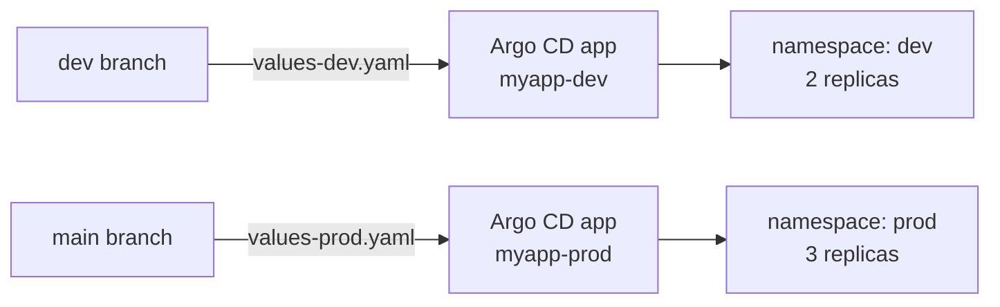

# Helm GitOps Demo

A GitOps setup with Helm and Argo CD: one chart, deployed to two environments, where each environment tracks its own Git branch.



## How it works

| Environment | Branch | Values file | Namespace |
|---|---|---|---|
| Dev | `dev` | `values-dev.yaml` | `dev` |
| Prod | `main` | `values-prod.yaml` | `prod` |

- Both Argo CD Applications use **automated sync** with `prune` and `selfHeal`, so the cluster always matches Git, and manual changes in the cluster are reverted.
- `CreateNamespace=true` creates the target namespace on first sync.
- Promoting a change to production means merging `dev` into `main`; there is no `kubectl apply` from a laptop or CI runner.

## Layout

```
argocd/dev-app.yaml        Argo CD Application for dev
argocd/prod-app.yaml       Argo CD Application for prod
charts/myapp/              Helm chart (Deployment, Service, Ingress, HPA, ServiceAccount)
charts/myapp/values-*.yaml Per-environment overrides
```

## Usage

```bash
# Register both applications with Argo CD
kubectl apply -n argocd -f argocd/

# Render the chart locally for an environment
helm template myapp charts/myapp -f charts/myapp/values-dev.yaml
```
